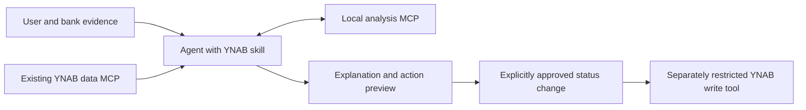

# YNAB Assistant

A portable agent skill and local analysis MCP for investigating YNAB reconciliation differences. Local alpha, not an official YNAB product.

Ask: "My card's posted bank balance is 125.00. What might explain the difference?" The skill fetches YNAB data through your existing MCP, the analysis engine checks the arithmetic, and the agent explains which transactions need bank confirmation.

## What works

* Bounded signed-integer searches for combinations of uncleared entries.
* Specific digit-transposition clues, including previously cleared records.
* Conservative statement comparison that preserves duplicate ambiguity.
* Read-only previews of cleared-status changes, with stale-data detection.
* A portable skill with evidence requirements and a narrowly scoped action workflow.

The agent workflow also covers authorized categorization, import acceptance, and previewed transaction reconciliation when the connected data MCP exposes the corresponding restricted tools. Those writes run through the data MCP; the analysis server remains credential-free and read-only. The implementation under review is [YNAB MCP PR #31](https://github.com/redlinelabs-dev/ynab-mcp/pull/31).

The analysis MCP has no credentials, network client, write tools, or built-in financial-data storage. It accepts snapshots supplied by the agent. Your existing YNAB data MCP manages authentication and any permitted status changes. A balance match alone never establishes that a charge posted.



## Run locally

Requires Node.js 22 or newer and npm. From this checkout:

```sh
npm ci --ignore-scripts
npm test
npm run demo
npm run benchmark
```

Check `node --version` in the shell used for npm, not just the Node executable configured in your MCP host. Test and benchmark commands fail early with a clear message on unsupported runtimes. Test output uses the spec reporter so protocol-test failures include their details.

The demo uses only synthetic data. The benchmark exercises a 1,000-entry register and reports search limits rather than claiming an exhaustive answer.

Snapshots use calendar dates such as `as_of: "2026-10-17"`, never timestamps. Completeness claims require explicit retrieval provenance as shown in the demo. An upstream response below its row cap can still omit old entries because of a default date window. See the workflow reference for the full retrieval check.

Configure a stdio MCP named `ynab-analysis` in your agent host, using an absolute Node path and checkout path:

```json
{
  "mcpServers": {
    "ynab-analysis": {
      "command": "/absolute/path/to/node",
      "args": ["/absolute/path/to/ynab-assistant/bin/ynab-assistant.js", "mcp"]
    }
  }
}
```

Host configuration formats vary; this is the common `mcpServers` form. Keep your existing authenticated YNAB MCP configured alongside it. Install the complete [skill folder](skills/ynab-assistant) into your host's skill discovery directory. It includes a required workflow reference. Avoid installing duplicate skills with the same name.

For offline CLI analysis:

```sh
node bin/ynab-assistant.js analyze /path/to/snapshot.json --bank-balance=125.00
```

The [example](examples/reconciliation.json) contains a snapshot and a balance. Pass just its `snapshot` object as the CLI snapshot file. Use `--signed` when a positive card balance represents a credit rather than debt. Tool inputs are described by their MCP schemas and the [workflow reference](skills/ynab-assistant/references/reconciliation.md).

## Limits of this alpha

This is a developer alpha, not a YNAB product. Balance checks, categorization, acceptance, and transaction reconciliation have been exercised against live accounts without publishing their data. Live cases so far have balanced after using the correct posted bank balance; a genuine unmatched bank/register discrepancy still needs live validation. Public API reconciliation updates transaction flags but does not update the account's last-reconciled date.

The solver caps states, operations, elapsed time and returned candidates. An incomplete search cannot establish uniqueness or absence of a solution. The wall-time check covers the core search, not total process startup and serialization. Input consistency cannot prove that the upstream MCP fetched every page.

Statement matching currently requires exact normalized merchant text, signed amount, and a nearby date. It intentionally leaves merchant aliases and duplicate candidates for review. PDF extraction, bank access, automatic scheduling, and a general write gateway are not included.

Verified with Linux and Node 24 using a real stdio MCP client. Other hosts and operating systems need compatibility testing. [Development roadmap](ROADMAP.md), [privacy and security](SECURITY.md), and [contributing](CONTRIBUTING.md).

## Provenance

Original MIT-licensed implementation. YNAB Toolkit's reconciliation behavior inspired the problem; its implementation is not vendored. This project does not attempt to reproduce browser-only UI customizations.
